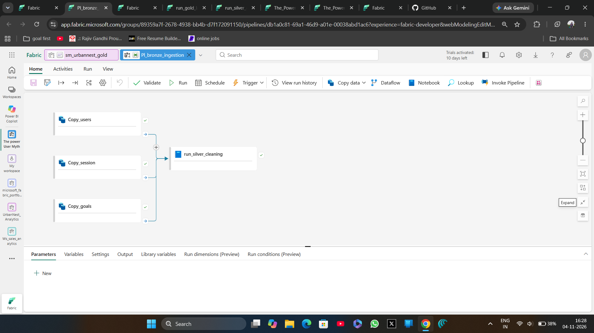
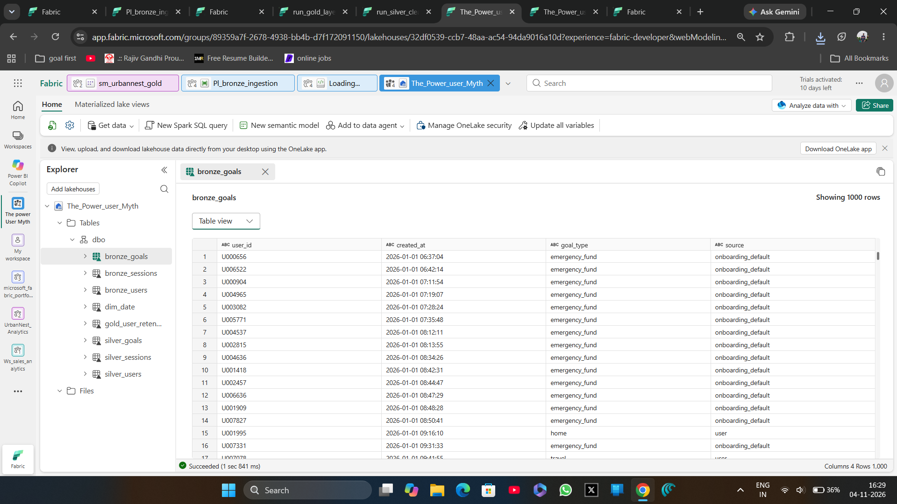
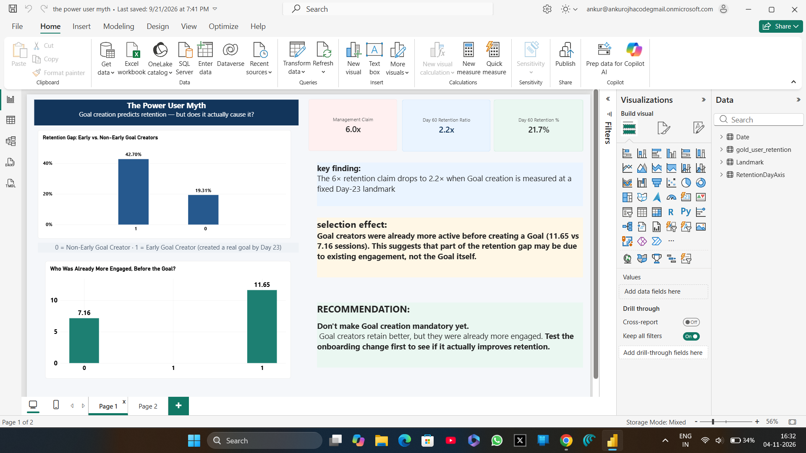
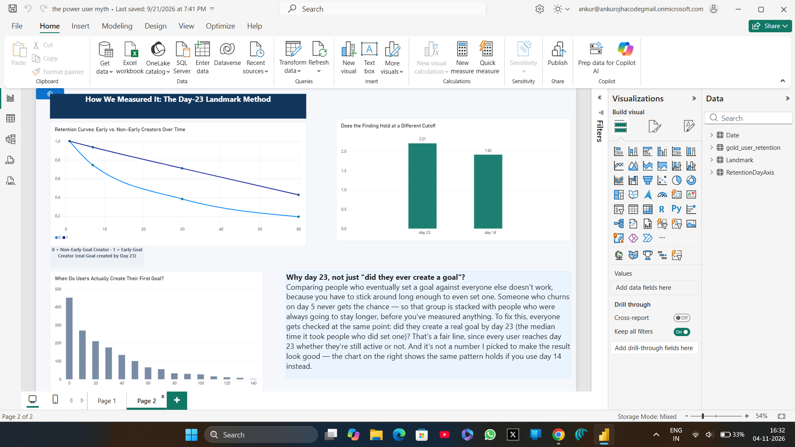

# power_user_myth_DE_P
does creating a goal make users stay, or do engaged users create goals? retention analysis on a finance app using a microsoft Fabric medallion pipeline (bronze/silver/gold) with PySpark, SQL and power BI.

project steps:
pipeline architecture - pipeline.png
lakehouse architecture - lakehouse.png
semantic model - semantic model relationship power user myth.png
project findings - findings.png and landmark.png 

The Power User Myth: Does Creating a Goal Make Users Stay?

Result: The "6x better retention" claim for Goal users drops to about 2.2x when measured at a fixed day-23 landmark (42.7% vs 19.3% day-60 retention). Goal creators were also already more active before creating a goal (11.65 vs 7.16 sessions). Recommendation: don't make Goal creation mandatory yet. A/B test it first.

Tools: Microsoft Fabric (Lakehouse, Data Pipeline, PySpark notebooks, SQL), Power BI

Problem
Halden, a personal-finance app, saw 58% day-60 retention for users with a Goal vs 9% without. Growth wanted to make Goal creation mandatory in onboarding. Does the Goal keep users, or do engaged users simply create Goals?

 Architecture (medallion)
- Bronze: a Fabric pipeline copies raw users, sessions and goals into the Lakehouse
- Silver (PySpark): cleans platform and country, drops `onboarding_default` goals, keeps each user's first real goal, and computes days since signup
- Gold (SQL): retention flags (day 1/7/30/60), early-goal flags and pre-goal session counts
- Semantic model: `gold_user_retention` joined to a Date dimension for Power BI
- Method: a day-23 landmark comparison instead of "ever created a goal", to reduce the bias that users must stay long enough to set a goal

 Screenshots
 Ingestion pipeline

 Lakehouse tables

 Semantic model

 Findings

 Day-23 landmark method

 Limitations and next steps
- Restrict the landmark comparison to users still active at day 23
- Use the auto-created default goals as a natural experiment

## Files
- `run_silver_cleaning.py`: bronze to silver
- `run_gold_layer.py`: silver to gold
